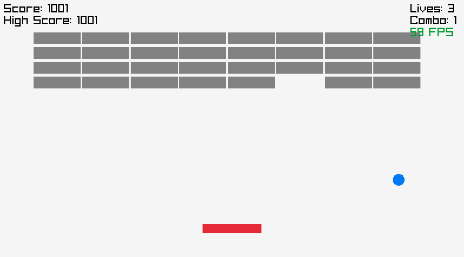

# Raylib Pong

This is a recreation of the 1976 Atari game Breakout, made in C++ using the raylib library.

You have 3 lives to knock out all the bricks and go for a high score.

## Rules

You have 3 lives, and when your ball passes ender your puck, you lose a life. Lose 3 lives and its game over.

You just control the puck with the left and right arrow keys.

Each consecutive hit the ball makes witb a brick, the combo counter will increase by one. You get an extra 1000 points multiplied by your combo.

## How to Compile

Run:

```bash
 cmake -B build
 cmake --build build
 ./build/example
 ```

In terminal, while in the file directory to compile and run.

## Media





